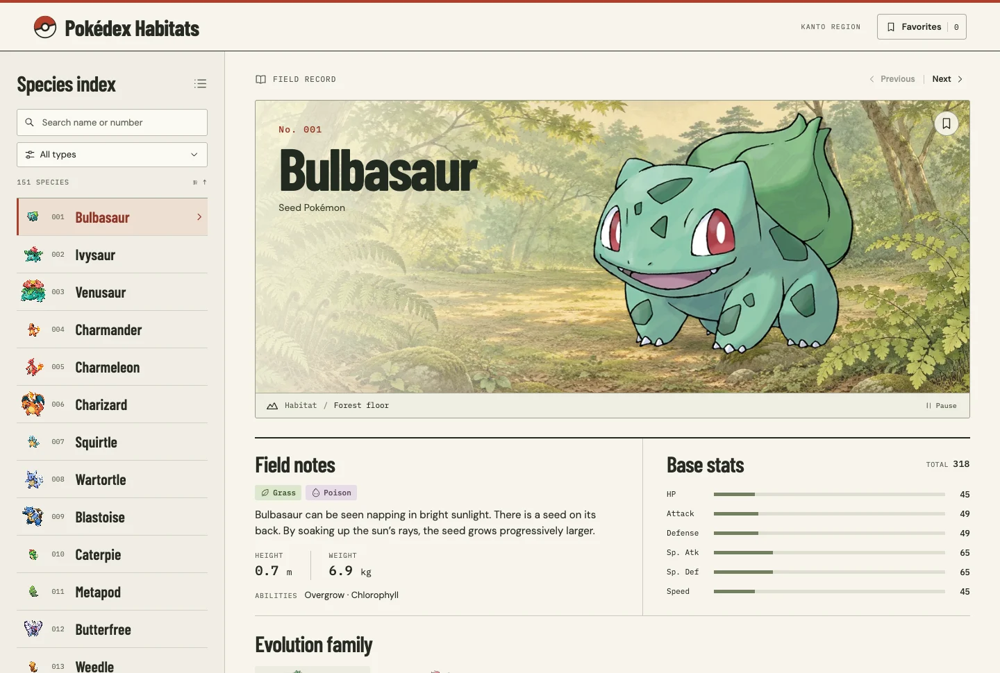

# Pokédex Habitats

A React Pokédex for the original 151 Pokémon. Watch leaves drift past Bulbasaur, embers rise behind Charmander, and ripples spread around Squirtle. Each Pokémon has a shareable field record with its official artwork, measurements, abilities, base stats, and Kanto evolutions.

[Open the live Pokédex](https://tedy69.github.io/react-pokedex-habitats/) · [Visit Pikachu’s grassland](https://tedy69.github.io/react-pokedex-habitats/#/pokemon/25) · [Explore Eevee’s family](https://tedy69.github.io/react-pokedex-habitats/#/pokemon/133)

[](https://tedy69.github.io/react-pokedex-habitats/)

## Run locally

Use Node.js 26.13.1 and pnpm 12.18.0. If you use nvm, run `nvm install` in the cloned directory to select the pinned Node version.

```sh
git clone https://github.com/tedy69/react-pokedex-habitats.git
cd react-pokedex-habitats
pnpm install --frozen-lockfile
pnpm dev
```

Open the local URL printed by Vite. The repository includes the data, artwork, and habitats. You can run the app without an API key or a backend.

## Where to start in the code

| If you want to learn how to… | Start here |
| --- | --- |
| Render four habitats with a single React Three Fiber canvas | [Scene.tsx](src/habitat/Scene.tsx) and [the habitat shaders](src/habitat/shader.ts) |
| Pause offscreen rendering and respect reduced motion | [Habitat.tsx](src/habitat/Habitat.tsx) |
| Fetch a species record on demand and cache it by ID | [The data loader](src/data/index.ts) |
| Crossfade artwork while the user switches species | [Artwork.tsx](src/Artwork.tsx) |
| Display evolution branches such as Eevee’s | [Records.tsx](src/Records.tsx) |

To change a species’ habitat assignment, edit `chooseHabitat` in [the generator](scripts/generate-kanto.mjs). To rebuild the dataset from PokéAPI v2, install ImageMagick 7 and run `pnpm exec node scripts/generate-kanto.mjs --refresh`.

## Build and deploy

```sh
pnpm lint
pnpm typecheck
pnpm build
pnpm preview
```

Deploy `dist/` to a static host. Individual records use hash URLs so they can be opened directly. For a fork on GitHub Pages, enable Actions, select **GitHub Actions** under **Settings → Pages**, and run the **Publish Pokédex** workflow from the Actions tab.

## Credits

Species records come from [PokéAPI](https://pokeapi.co/). Pokémon names, characters, sprites, and official artwork belong to their respective rights holders. The image source is the [PokéAPI sprites collection](https://github.com/PokeAPI/sprites). Pokédex Habitats is an unofficial fan project.
